# Screenshots

Every screenshot from the build, in order. Passwords and recovery keys are blacked out.

## Domain controller and network

**Renamed the server to DC01**

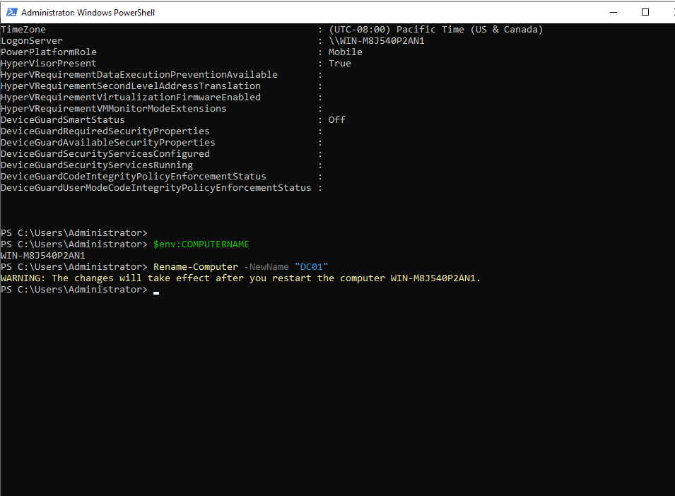

**Named the adapters LabNet and Default Switch**

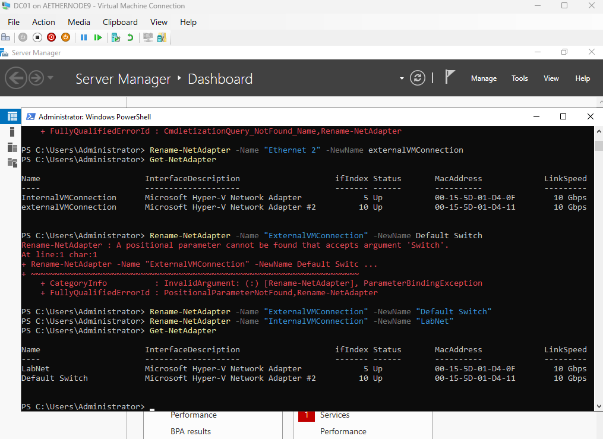

**Added a second NIC on the Default Switch for internet access**

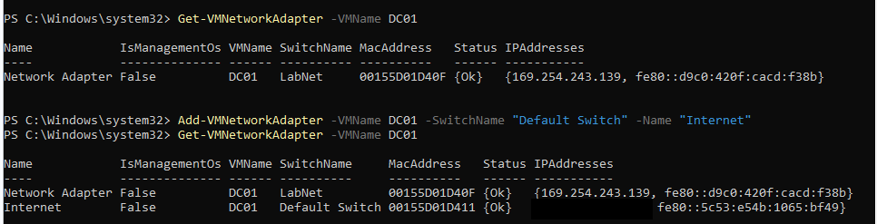

**Static lab IP, and DNS registration turned off on the internet adapter**

**Internet test with Test-NetConnection on port 443**

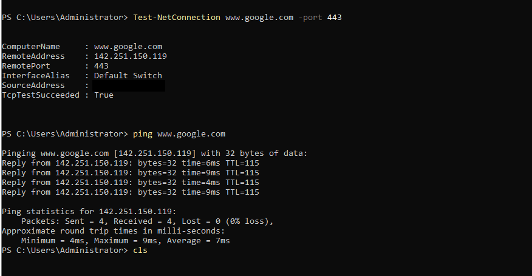

**Domain controller verified with nltest; DHCP authorized in AD**

**Ghost DNS record (172.x) before and after cleanup**

**DNS forwarders added and outside name resolution tested**

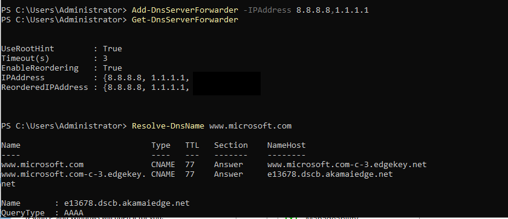

**DHCP scope created**

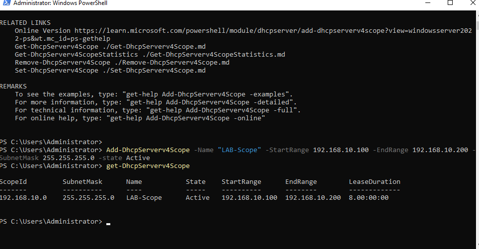

**Server Manager flag cleared; core services running**

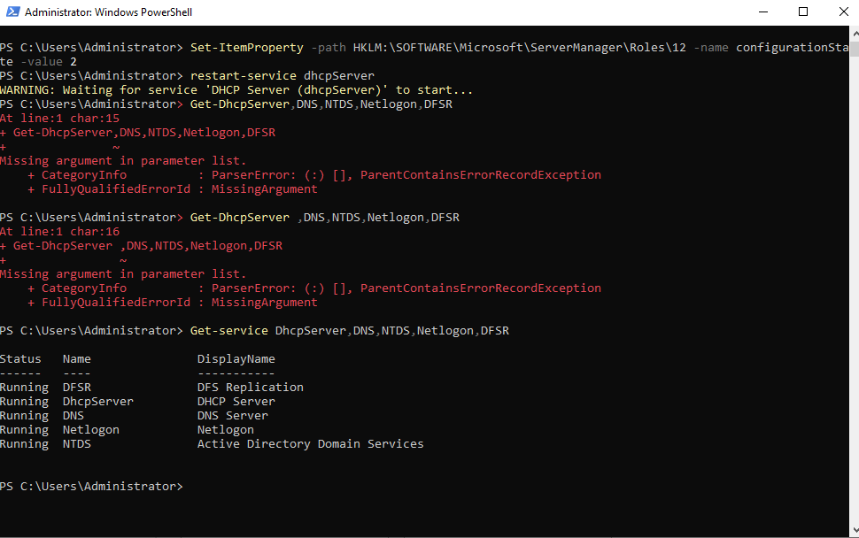

## Reference image

**Reference machine firmware and TPM check**

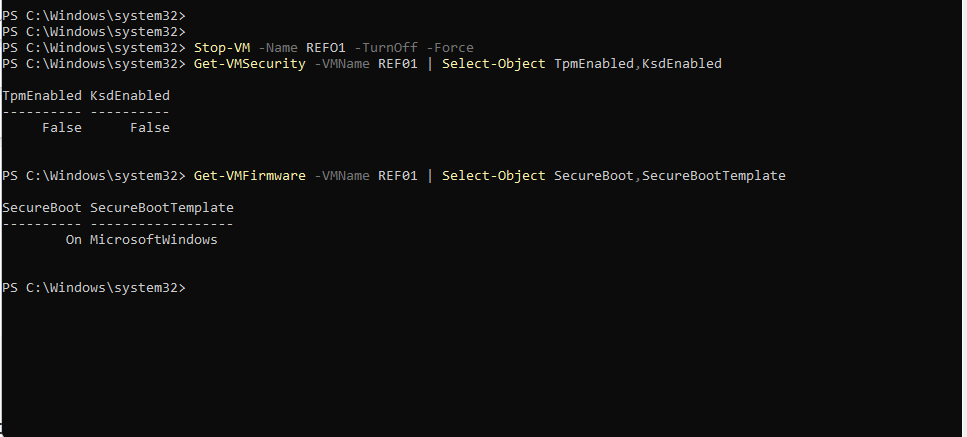

## Identity

**OU structure created and verified**

**Default computer and user containers redirected to OUs**

**Security groups created (note the SEC-Warhouse-Staff typo that caused HELP-2)**

**New hire CSV**

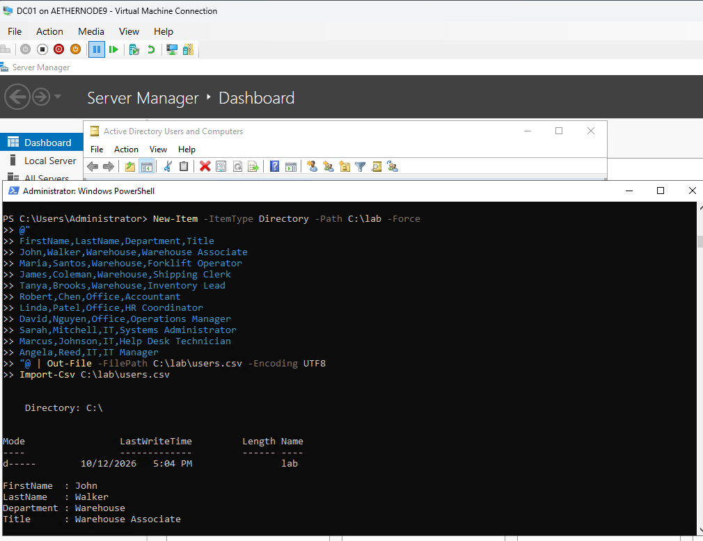

**Bulk user script and output**

**Termination script run on a test user**

## Workstations

**WS01 gets its reserved address, 192.168.10.150**

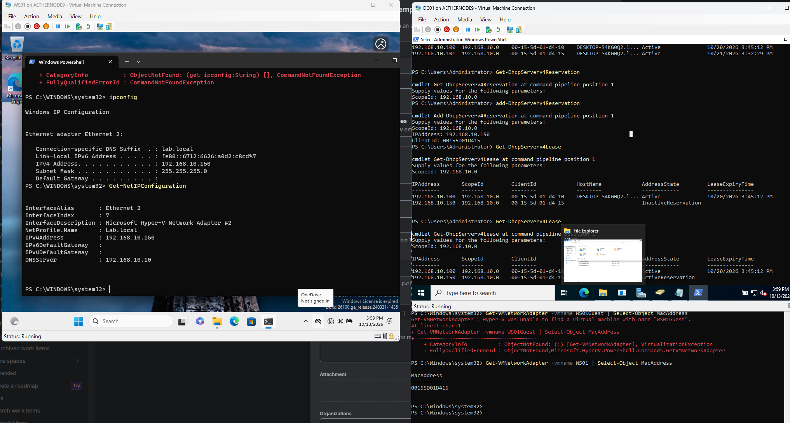

**Domain join failed on a typo (Adminstrator), then retried**

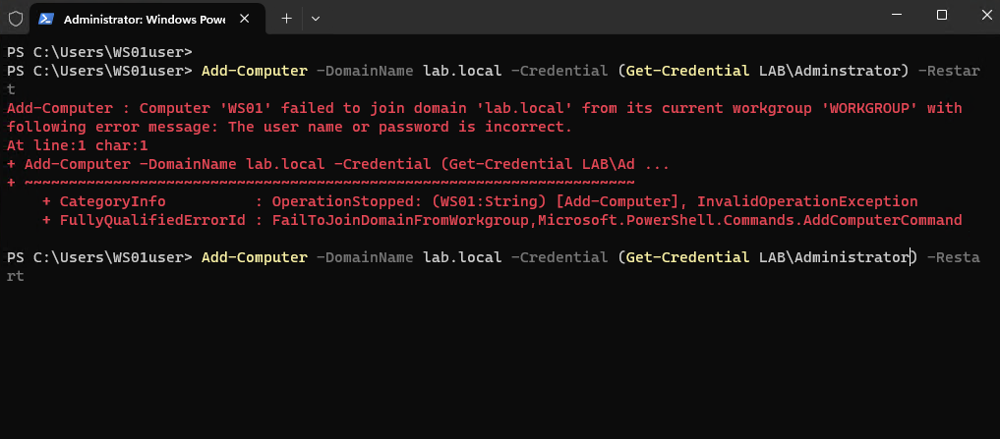

## Group Policy

**GPOs created and linked with PowerShell**

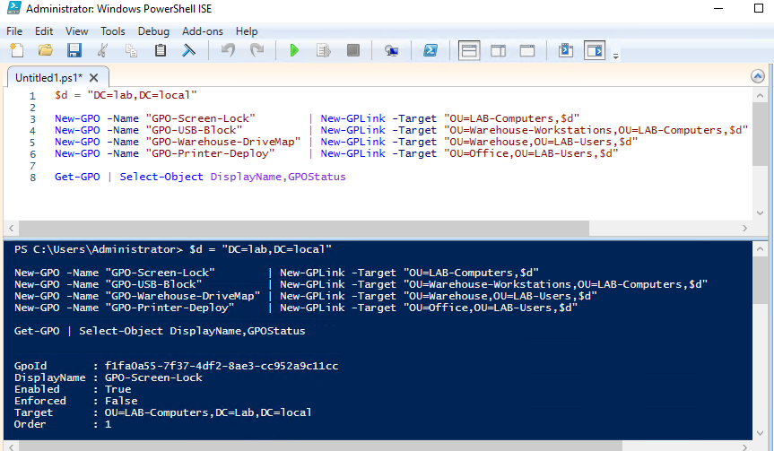

**GPO links in Group Policy Management**

**Password policy settings**

**Computer policy applied on WS01 (Office-Workstations)**

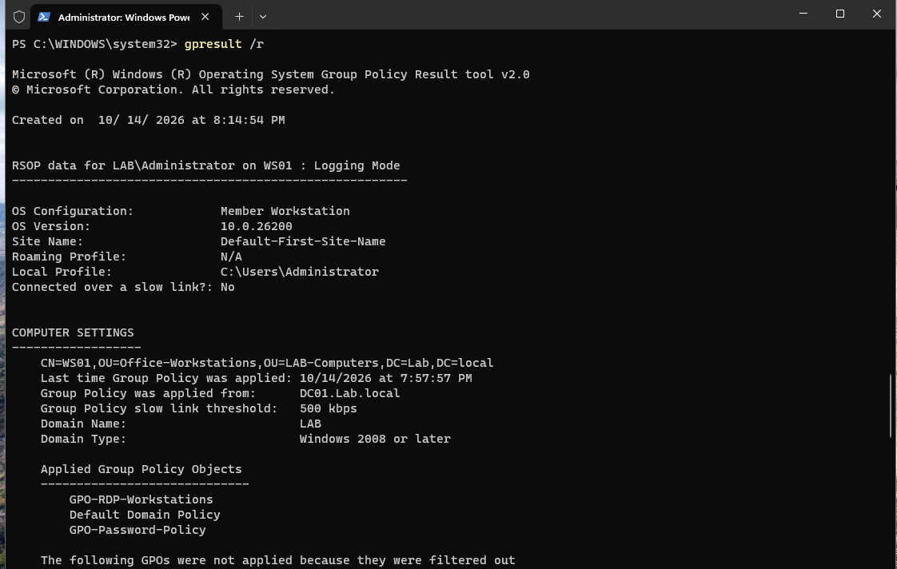

**Drive map GPO applied to a warehouse user**

**Drive map path typo (WarehousesShare) that caused part of HELP-2**

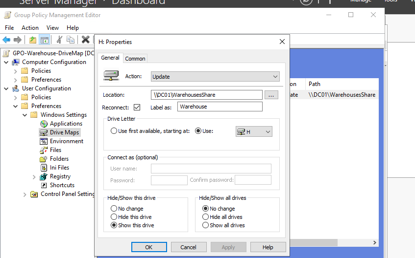

## Remote Desktop

**RDP port 3389 reachable on WS01**

**Warehouse user refused remote sign-in**

## BitLocker

**TPM ready; recovery password added (redacted)**

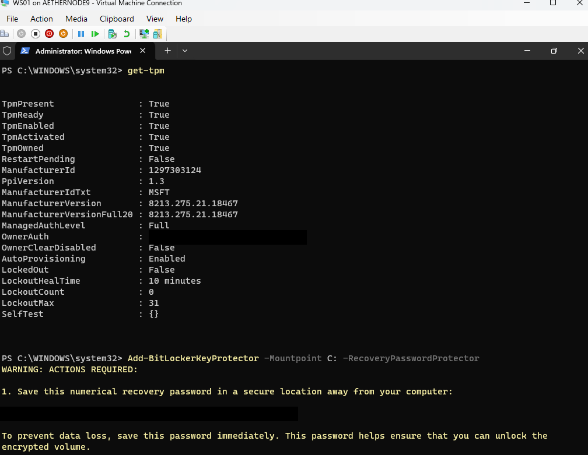

**The two Enable-BitLocker errors**

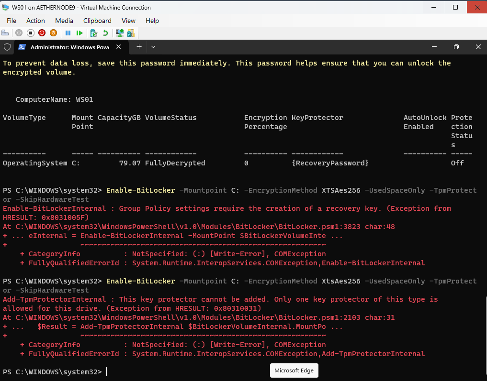

**Recovery password protector added (redacted)**

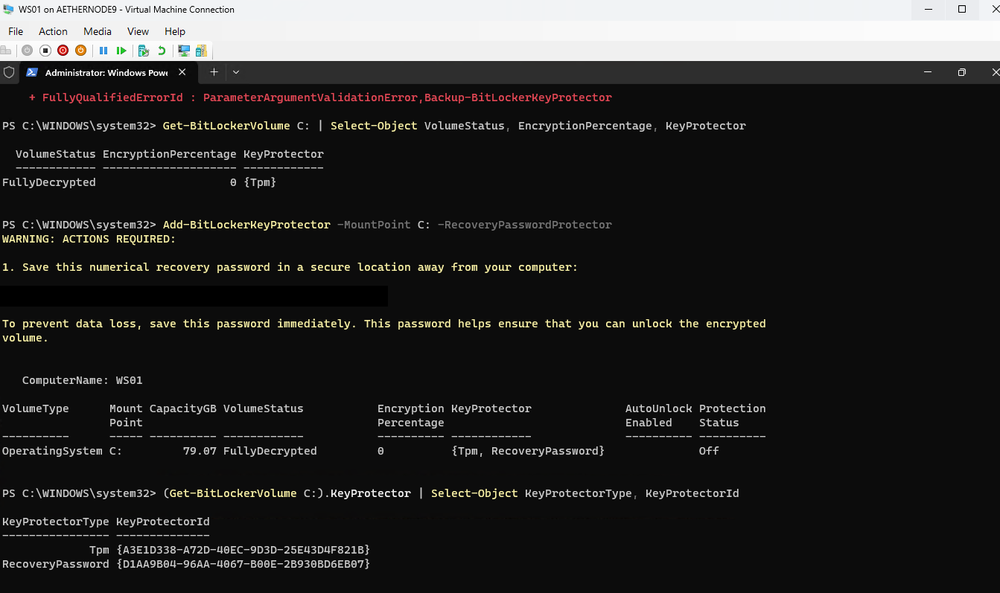

**Key backed up to AD and encryption started**

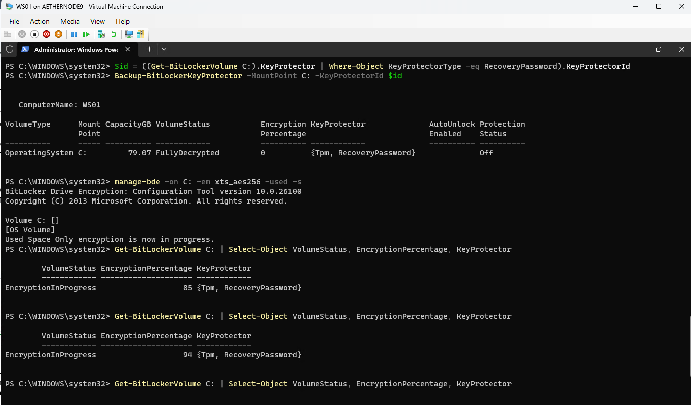

**Fully encrypted; recovery key on the computer object in AD (redacted)**

## Service desk (Jira)

**HELP-1: onboarding request, resolved**

**HELP-2: share creation incident**

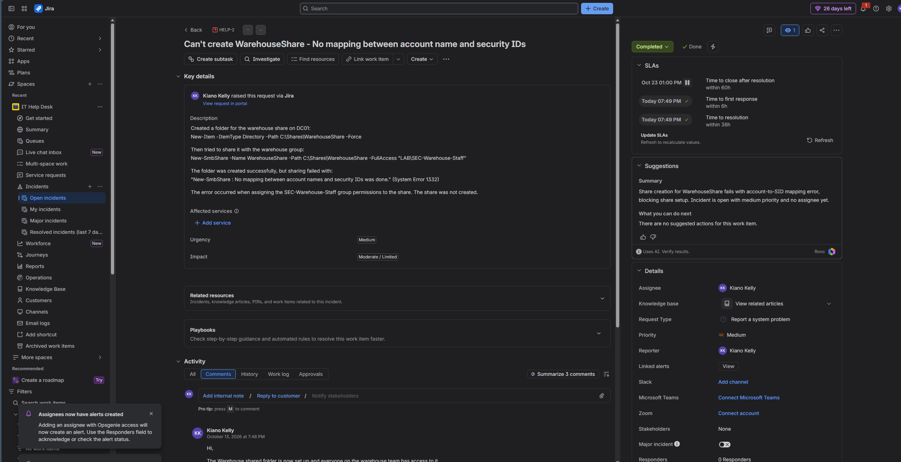

**HELP-2: internal notes and customer reply**

