# Windows Active Directory Home Lab

A small-company Windows environment built from scratch on Hyper-V: a domain controller, a golden-image deployment process, department-based users and groups, Group Policy, a departmental file share, scoped Remote Desktop, and BitLocker with recovery keys backed up to Active Directory.

I planned the build in phases, documented every step, and tracked the work as service desk tickets in Jira Service Management.

**Skills shown:** Active Directory, DNS, DHCP, Group Policy, Sysprep/imaging, Hyper-V, PowerShell, SMB/NTFS permissions, BitLocker, ticket-based troubleshooting (Jira Service Management)

## Project summary
I scripted the identity side in PowerShell: the OU structure, and a provisioning script that creates users from a CSV and places them in the right OU and security group by department. I set up a golden-image workflow by generalizing a Windows 11 reference machine with Sysprep and deploying new workstations from that image, which boot to setup in about three minutes instead of a full install. With the default computer container redirected, new machines join straight into an OU where Group Policy applies, so they get baseline security without manual setup. I enabled RDP through a GPO scoped to the help desk group and verified it by confirming a non-help-desk user was refused. BitLocker is enforced through a policy that won't let encryption start until the recovery key is stored in AD, so a user's key can be pulled from their computer object when they're stuck at a recovery screen.

## Repo contents
| Folder / file | What's in it |
|---|---|
| [`tickets/`](tickets/) | Service desk tickets: requests and incidents with internal notes and customer replies |
| [`scripts/`](Scripts/) | PowerShell scripts for OUs, user provisioning, offboarding, and GPOs |
| [`troubleshooting.md`](docs/troubleshooting.md) | Problems I hit and how I solved them |
| [`runbook-department-share.md`](docs/runbook-department-share.md) | Step-by-step runbook for creating a department file share |
| [`lab-notes.md`](docs/lab-notes.md) | My build notes, in plain language |
| [`screenshots.md`](docs/screenshots.md) | Every screenshot, in build order |

## How this maps to IT roles

| What job descriptions ask for | Where it's shown in this project |
|---|---|
| Manage Active Directory users, groups, and OUs | OU design, bulk provisioning from CSV, offboarding script |
| Onboarding / offboarding | [HELP-1](tickets/01-onboard-new-hires.md), [`Terminate-User.ps1`](scripts/Terminate-User.ps1) |
| Group Policy management | Seven GPOs scoped by department and computer type |
| Troubleshoot user access and permissions | [HELP-2](tickets/02-warehouse-share-access.md): share vs. NTFS permissions, group membership |
| Log, track, and resolve tickets in an ITSM tool | Work tracked in Jira Service Management with internal notes, customer replies, and SLAs ([tickets/](tickets/)) |
| Clear communication with end users | Plain-language customer replies on each ticket |
| Endpoint deployment / imaging | Sysprep golden image, workstations deployed from it |
| Endpoint security and encryption | BitLocker with recovery keys escrowed to AD, USB storage blocked by policy |
| Remote support (RDP) | RDP scoped to help desk by GPO, tested in both directions |
| DNS / DHCP administration | DNS cleanup and forwarders, DHCP scope, options, and reservations |
| Scripting and automation (PowerShell) | Scripts for OUs, users, offboarding, and GPOs |
| Documentation and knowledge base | Runbook, troubleshooting log, lab notes |

Relevant for: **IT Support / Help Desk, Desktop Support, Systems Administrator (junior), NOC Technician**.

---

## Lab layout

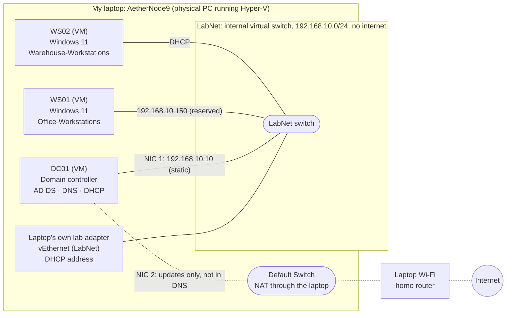

| Item | Value |
|---|---|
| Domain | `lab.local` (NetBIOS `LAB`) |
| Domain controller | DC01, static `192.168.10.10`, DNS points to itself |
| DHCP scope | `192.168.10.100 – .200`, DNS option `192.168.10.10` |
| Workstations | Windows 11, deployed from a Sysprepped golden image |
| Network | Hyper-V **internal** switch, so the lab's DHCP can't reach my home network |

**Why an internal switch:** DC01 runs a DHCP server. On an external switch it could hand out addresses on my real home network. The internal switch keeps the lab isolated, and DC01 gets a second NIC on NAT only for Windows updates, with DNS registration turned off so its outside address never becomes a bad DNS record.

---

## What I built

### 1. Domain controller, DNS, and DHCP
- Renamed the server to DC01 and gave it two adapters: **LabNet** (static 192.168.10.10) and **Default Switch** (internet for updates).
- Turned off DNS registration on the internet adapter so only the lab address goes into DNS.
- Promoted DC01 to a new forest (`lab.local`) with integrated DNS.
- After promotion, DNS still had a "ghost" record for the internet address (172.x). Removed it so clients only get 192.168.10.10.
- Added DNS forwarders (8.8.8.8, 1.1.1.1) for outside names.
- Authorized DHCP in AD, created the scope, and set DNS and domain options.

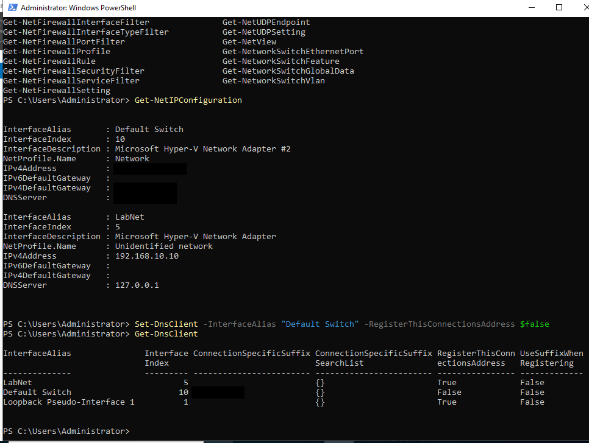
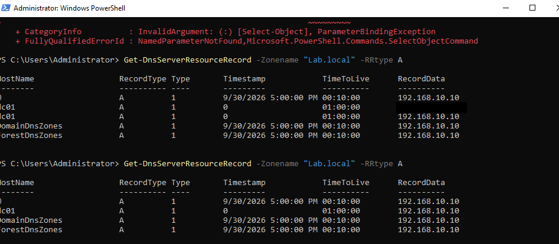
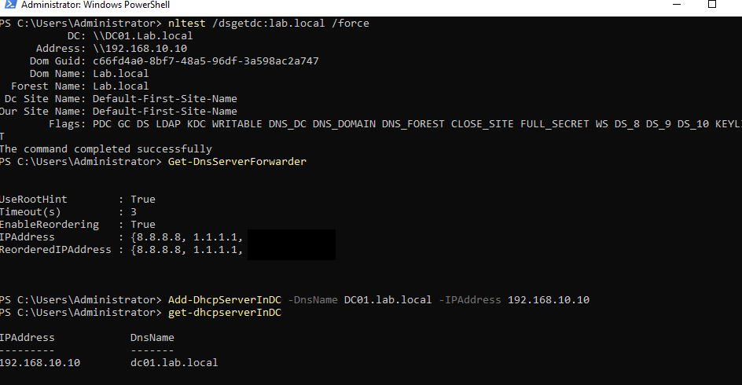

### 2. Golden image (Sysprep)
- Built a Windows 11 reference machine with a company build-info file and RDP enabled.
- Generalized it with `sysprep /generalize /oobe /shutdown`, which strips the machine's unique identity (SID, name) so every copy starts fresh.
- Captured the disk as a **read-only** golden image.

New workstations boot straight to setup in about **3 minutes instead of a 20-minute Windows install**.

> **Lesson learned:** Windows 11 turned on device encryption automatically on the reference machine, which blocks Sysprep. I had to fully decrypt the drive before generalizing.

### 3. OU structure and redirection
Designed OUs by function so Group Policy can be targeted precisely ([`Create-OUs.ps1`](scripts/Create-OUs.ps1)):

```
lab.local
├── LAB-Users
│   ├── Warehouse
│   ├── Office
│   └── IT
├── LAB-Computers
│   ├── Warehouse-Workstations
│   ├── Office-Workstations
│   └── Handhelds
├── LAB-Groups
├── LAB-ServiceAccounts
└── LAB-Disabled
```

Used `redircmp` and `redirusr` so new computers and users land in OUs (which accept GPO links) instead of the default containers (which don't).

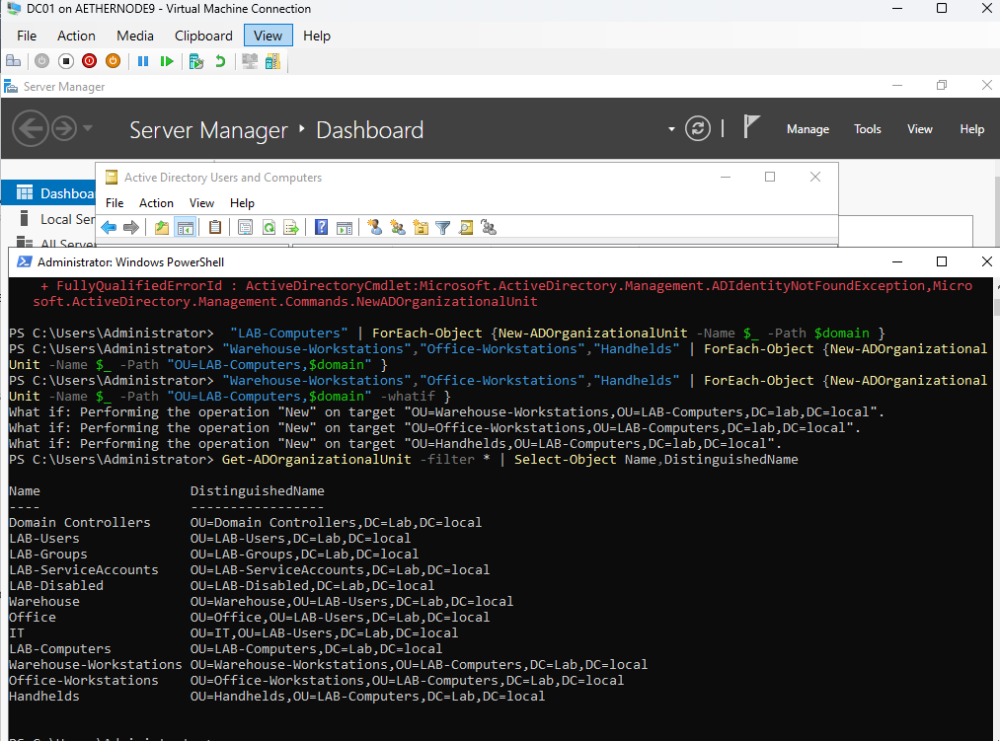
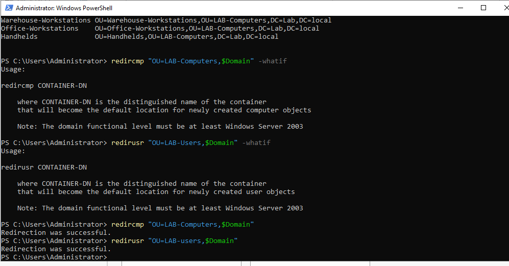

### 4. Users and groups: provisioning from CSV
[`BulkUser_creation.ps1`](scripts/BulkUser_creation.ps1) reads new hires from [`users.csv`](scripts/users.csv) and:
- builds usernames (`first.last`) and skips accounts that already exist, so it's safe to re-run
- places each user in their department's OU and adds them to their department's security group
- forces a password change at first sign-in

I previewed it with `-WhatIf` before running it for real, and tracked the work as [HELP-1](tickets/01-onboard-new-hires.md).

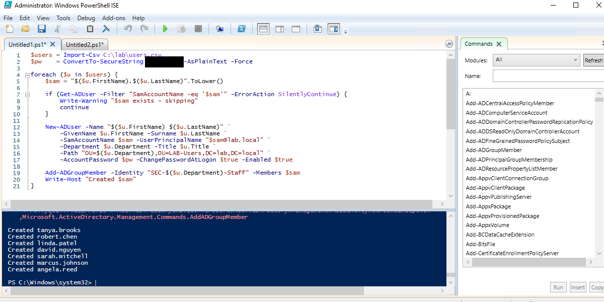

### 5. Offboarding script
[`Terminate-User.ps1`](scripts/Terminate-User.ps1) disables the account, resets the password, removes group memberships, moves the account to `LAB-Disabled`, and logs the termination along with the groups removed, so an accidental termination can be reversed.

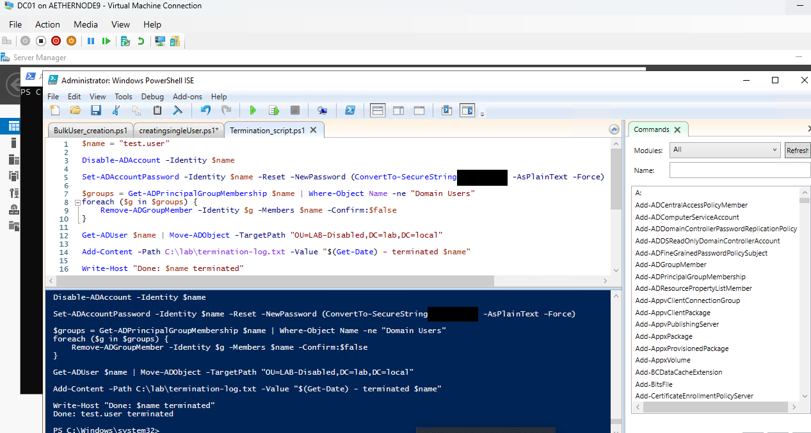

### 6. Group Policy
Created and linked GPOs with PowerShell ([`Create-GPOs.ps1`](scripts/Create-GPOs.ps1)), then configured each one in the editor.

| GPO | Linked to | What it does |
|---|---|---|
| GPO-Password-Policy | `lab.local` (domain root) | 14-character minimum, complexity, lockout after 5 attempts |
| GPO-Screen-Lock | LAB-Computers | Locks after 10 minutes idle |
| GPO-USB-Block | Warehouse-Workstations | Denies all removable storage |
| GPO-Warehouse-DriveMap | LAB-Users/Warehouse | Maps `H:` to `\\DC01\WarehouseShare` |
| GPO-Printer-Deploy | LAB-Users/Office | Deploys the office printer |
| GPO-RDP-Workstations | LAB-Computers | Enables RDP, opens the firewall to the lab subnet, adds IT Helpdesk to Remote Desktop Users |
| GPO-BitLocker-Escrow | LAB-Computers | Requires recovery keys to be saved to AD before encryption is allowed |

**Scoping is the point.** USB-Block applies to warehouse machines only, and the drive map follows warehouse *users* to any computer they sign into.

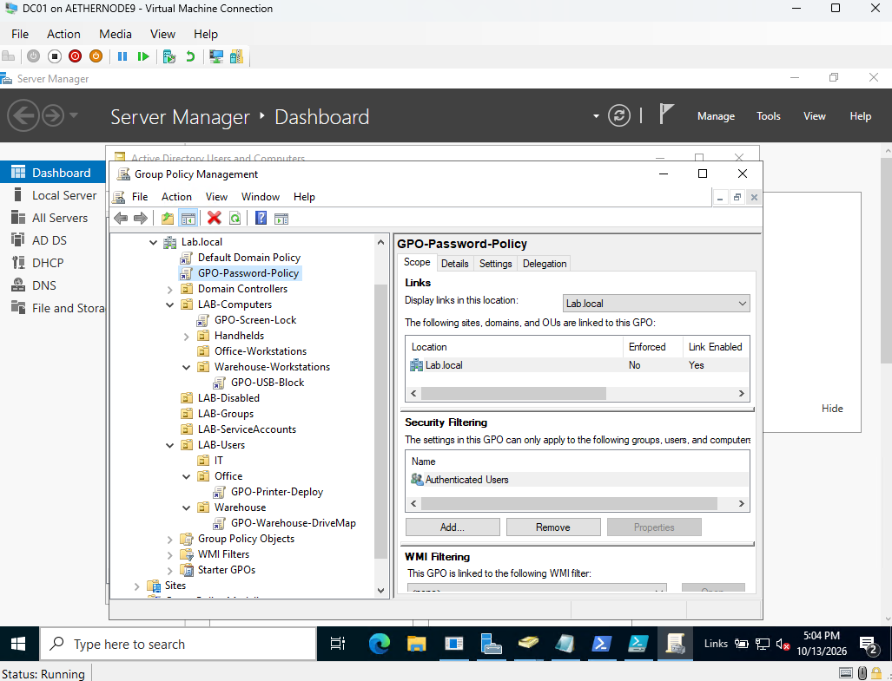
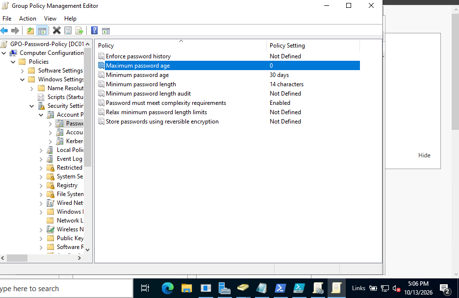
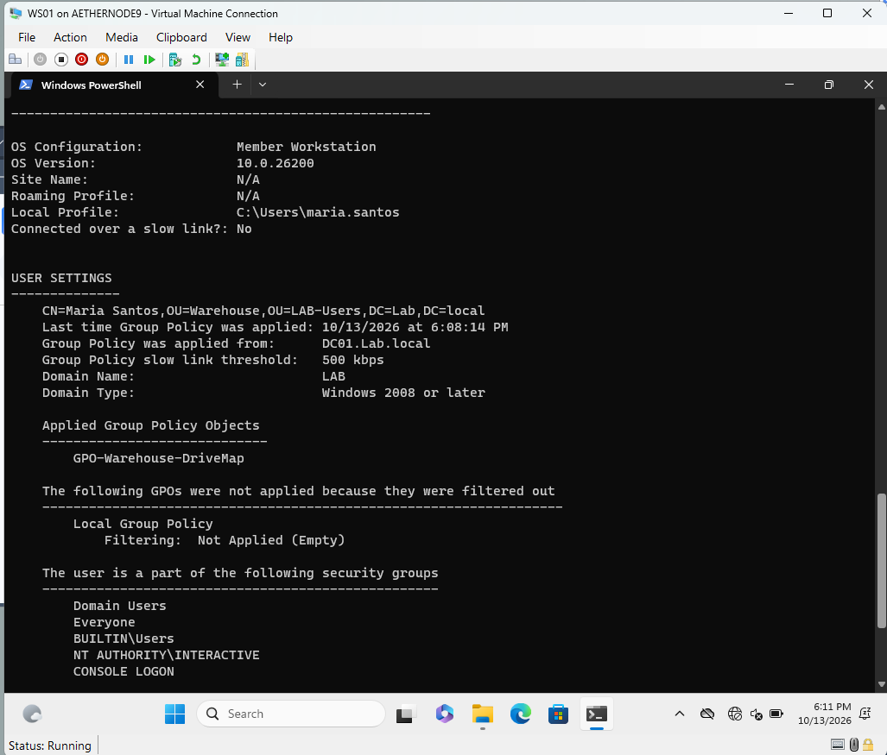

### 7. Department file share
Created `\\DC01\WarehouseShare` for the warehouse team, with both **share** and **NTFS** permissions granted to `SEC-Warehouse-Staff`, mapped automatically as `H:` by Group Policy. Getting this working took three separate fixes, documented in [HELP-2](tickets/02-warehouse-share-access.md).

See the runbook: [`docs/runbook-department-share.md`](docs/runbook-department-share.md)

### 8. Remote Desktop, scoped by policy
One GPO with three independent settings (service on, firewall exception limited to `192.168.10.0/24`, Remote Desktop Users group membership). Tested in **both directions**:

| User | Result |
|---|---|
| `marcus.johnson` (IT Helpdesk) | ✅ Connects |
| `maria.santos` (Warehouse) | ❌ Refused |

Proving the wrong person is blocked matters as much as proving the right person gets in.

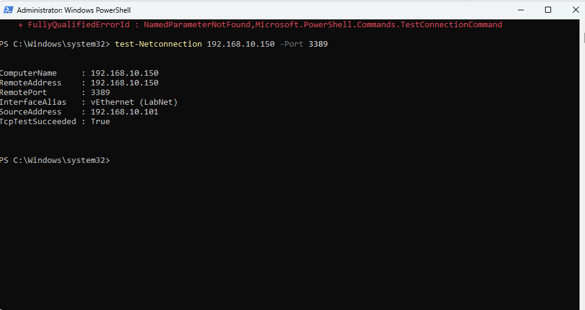
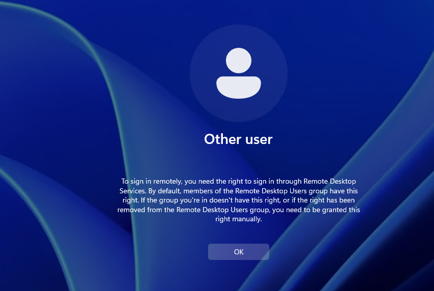

### 9. BitLocker with recovery keys in AD
- Escrow GPO applied **before** encrypting, with "do not enable BitLocker until recovery information is stored in AD DS" turned on.
- Confirmed the virtual TPM was ready, added a recovery password, then encrypted with a TPM protector (automatic unlock at boot).
- Matched the recovery Password ID on the workstation to the entry on the computer object in ADUC.

If a user is ever locked out, help desk looks up the key in AD instead of the data being lost.

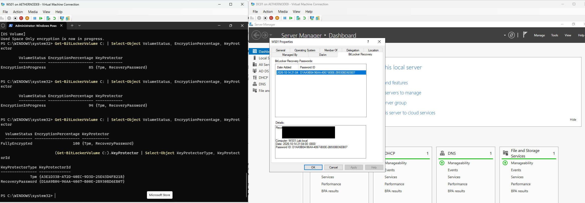

### 10. Second workstation from the image
Deployed WS02 from the golden image through Hyper-V Manager (copy the image → new VM using the existing disk → enable TPM), joined it to the domain and renamed it in one step, and moved it to Warehouse-Workstations so it picks up warehouse-only policy.

### 11. Service desk tracking
Logged the work in a Jira Service Management project, *IT Help Desk*, with internal notes for technical steps, plain-language customer replies, and SLA tracking.

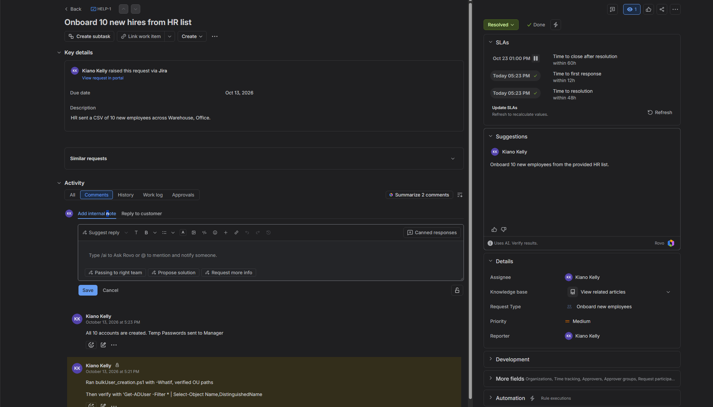
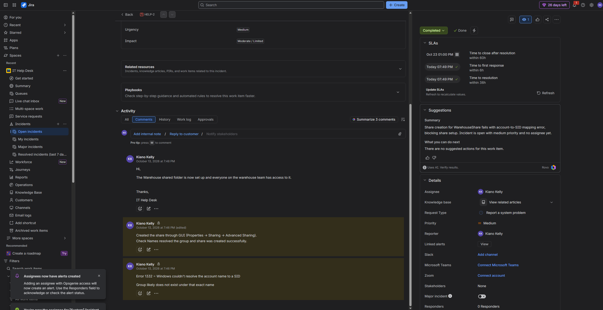

---

## Troubleshooting highlights

Real problems I hit and solved. Full write-ups in [`docs/troubleshooting.md`](docs/troubleshooting.md), and the ticket versions in [`tickets/`](tickets/).

| Symptom | Root cause |
|---|---|
| Warehouse team can't reach their drive | **Three** separate causes: a typo in the group name, missing NTFS permissions, and a typo in the drive map path |
| `New-SmbShare` error 1332 | Group was created as `SEC-Warhouse-Staff`, so PowerShell's exact-name lookup failed |
| Domain join failed: "user name or password is incorrect" | Typed `LAB\Adminstrator` instead of `LAB\Administrator` |
| Standard user blocked from the VM console | Hyper-V Enhanced Session uses RDP, and standard users don't have RDP rights |
| `Enable-BitLocker` error 0x8031005F | Escrow GPO was set to *require* a recovery key file instead of *allow* it |

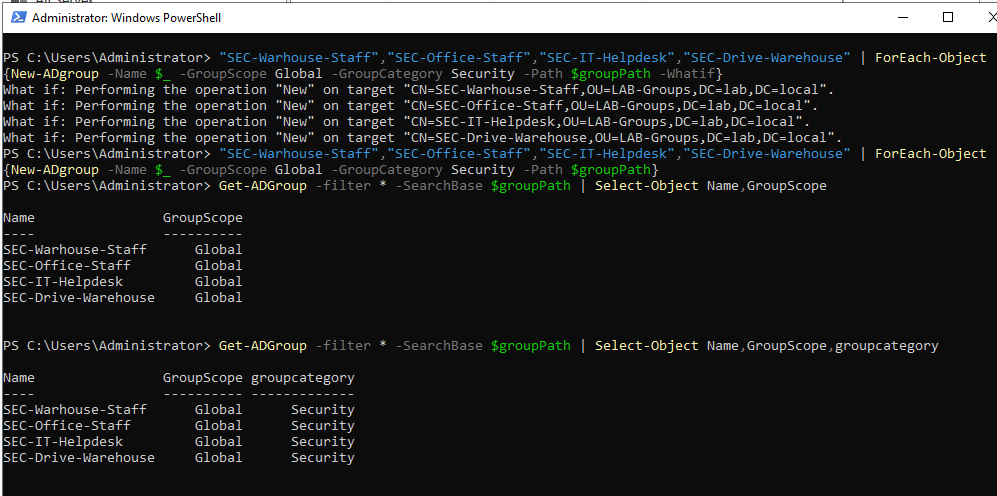

